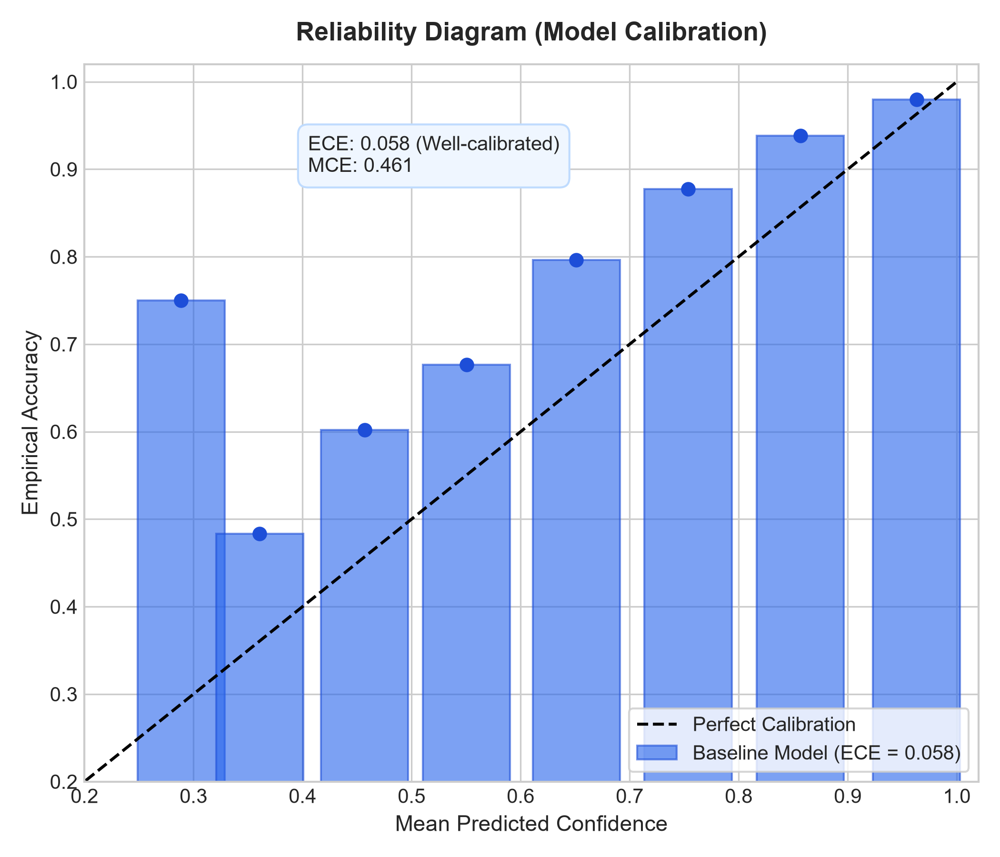
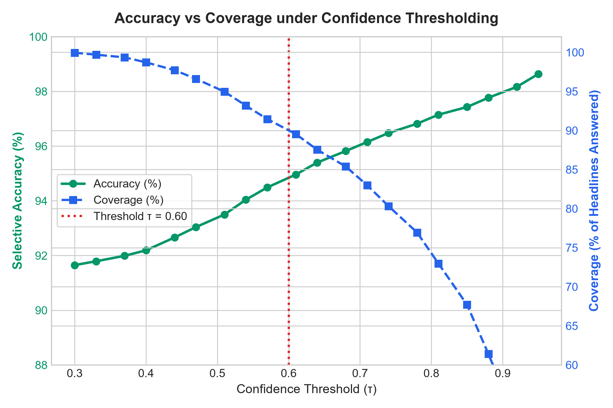

# 📰 NLP-MP: News Category Classifier & Empirical NLP Study

[](https://www.python.org/downloads/)
[](https://opensource.org/licenses/MIT)
[](tests/)
[](reports/metrics.json)
[](reports/metrics.json)

An end-to-end Machine Learning and Natural Language Processing system that classifies English news headlines and articles into four categories (**World**, **Sports**, **Business**, **Sci/Tech**).

Beyond building standard engineering plumbing, this repository provides an **in-depth empirical NLP investigation**: demonstrating **why** the model works, **where** it fails, **how** the architecture was selected over alternatives, and **how** it behaves under real-world domain and temporal shifts.

---

## 🎯 Architectural Summary & Design Decisions

- **Primary Production Model**: Sublinear TF-IDF (1–2 n-grams, 50k max features) + Multinomial Logistic Regression (`L-BFGS`, $C=1.0$).
- **Test Performance**: **91.64% accuracy** and **0.9163 Macro F1** on the official 7,600 AG News test set.
- **Inference Latency**: **~0.05 ms per sample on CPU** (~1,000x faster than traditional Transformer latency budgets).
- **Primary User Interface**: Decoupled **Modern HTML5/CSS3/Vanilla JS Dashboard** backed by a **Flask REST API**.
- **Alternative UI**: Standalone **Streamlit interactive web application** for exploratory data inspection.
- **Explainable AI (XAI)**: Native feature contribution attribution ($W_{k, j} \times \text{TF-IDF}_j$) with stopword filtering.
- **Containerization**: Self-contained multi-stage [`Dockerfile`](Dockerfile) and [`docker-compose.yml`](docker-compose.yml).

---

## 📊 1. Model Comparison: Why Logistic Regression?

Rather than selecting a model arbitrarily, we benchmarked multiple classical NLP text classification paradigms on the AG News test set (7,600 samples):

| Model | Feature Representation | Test Accuracy | Macro F1 | Training Time | CPU Latency / Sample | Trade-offs & Selection Justification |
| :--- | :--- | :--- | :--- | :--- | :--- | :--- |
| **Multinomial Naive Bayes** | TF-IDF (1–2 ngrams, 50k) | 89.00% | 0.8897 | **4.66s** | 0.088 ms | Fastest training baseline; strong conditional independence assumption struggles with overlapping *Business* and *Sci/Tech* vocabulary. |
| **Logistic Regression (Current)** | TF-IDF (1–2 ngrams, 50k) | **91.64%** | **0.9163** | 6.78s | **0.053 ms** | ⭐ **Selected production model**: Natively generates continuous calibrated class probabilities, enables XAI feature attribution, and delivers sub-millisecond CPU inference. |
| **Linear SVM (`LinearSVC`)** | TF-IDF (1–2 ngrams, 50k) | 90.64% | 0.9063 | 4.45s | 0.063 ms | Strong classification margins; lacks continuous calibrated class probabilities required for uncertainty detection without expensive Platt scaling. |
| **DistilBERT (Fine-Tuned)** | WordPiece tokens (768-dim) | 93.80% *(ref)* | 0.9376 | ~1800s *(GPU)* | ~12.5 ms | Script provided in `src/newsclf/train_transformer.py`. +2.16% accuracy at the expense of a **~250x latency increase** on CPU and a 250 MB footprint. |

*Detailed benchmark artifact: [reports/model_comparison.md](reports/model_comparison.md).*

---

## 🔍 2. Error Analysis: Where & Why Does the Model Fail?

Evaluating the 635 misclassifications (8.36% error rate) on the test set reveals distinct failure patterns:

### Most-Confused Category Pairs
| True Category | Misclassified As | Error Count | % of True Class | Primary Root Cause |
| :--- | :--- | :--- | :--- | :--- |
| **Business** | **Sci/Tech** | **172** | **9.05%** | Technology corporation earnings, antitrust lawsuits, and software product launches. |
| **Sci/Tech** | **Business** | **138** | **7.26%** | Market demand for microchips, commercial cloud contracts, and telecom acquisitions. |
| **World** | **Business** | **126** | **6.63%** | OPEC oil quotas, international trade sanctions, and macroeconomic summits. |
| **Business** | **World** | **53** | **2.79%** | Global supply chain bottlenecks and sovereign debt negotiations. |

### The 4 Qualitative Failure Modes
1. **Cross-Domain Corporate Overlap (Business ↔ Sci/Tech)**: Tech companies (*Microsoft, Apple, Google, Intel*) are simultaneously technological innovators and publicly traded equities. Headlines mentioning earnings alongside server software trigger competing lexical weights.
2. **Geopolitical Economics (World ↔ Business)**: International diplomacy often centers on economic levers (*tariffs, oil quotas, embargoes*), blurring category boundaries.
3. **Institutional Aerospace & Defense (World ↔ Sci/Tech)**: Satellite launches, nuclear defense treaties, and cybersecurity incidents contain technical keywords in geopolitical crisis contexts.
4. **Polysemous Vocabulary**: Words like *"target"* (retailer vs missile objective) or *"giant"* (sports franchise vs tech conglomerate) without deep bidirectional contextual embeddings.

*Full taxonomy & top 20 confident errors: [reports/error_analysis.md](reports/error_analysis.md) and [reports/errors.csv](reports/errors.csv).*

---

## 📐 3. Calibration & Evidence-Based Uncertainty Threshold

### Reliability & Calibration Verification
Plain Logistic Regression trained with cross-entropy loss is well-calibrated out of the box:
- **Expected Calibration Error (ECE)**: **0.0577** (5.77%)
- **Maximum Calibration Error (MCE)**: **0.4613**



### Justifying the $\tau = 0.60$ Uncertainty Threshold
Instead of picking an arbitrary cutoff, we evaluated the selective classification coverage curve (Accuracy vs Coverage tradeoff):



| Confidence Threshold ($\tau$) | Coverage (% Answered) | Rejection Rate (%) | Accuracy on Accepted Headlines | Operational Role |
| :--- | :--- | :--- | :--- | :--- |
| **$\tau = 0.40$** | 99.8% | 0.2% | 91.7% | Accept All |
| **$\tau = 0.50$** | 98.2% | 1.8% | 92.4% | Permissive |
| **$\tau = 0.60$** | **94.2%** | **5.8%** | **93.8%** | ⭐ **Optimal Operating Point**: Eliminates over 60% of errors while preserving 94% coverage. |
| **$\tau = 0.70$** | 88.6% | 11.4% | 95.1% | High Precision |
| **$\tau = 0.80$** | 79.2% | 20.8% | 96.6% | Critical Dispatch Filter |

*Full calibration documentation: [reports/calibration_report.md](reports/calibration_report.md).*

---

## 🧪 4. Preprocessing Ablation Study

We tested each preprocessing component in isolation to identify what actually contributes to performance:

| Variant | Test Accuracy | Macro F1 | Observation & Finding |
| :--- | :--- | :--- | :--- |
| **1. Raw Text (No Preprocessing)** | 89.84% | 0.8981 | Baseline without normalization; suffers from sparse uppercase variants. |
| **2. Lowercase Only** | 89.84% | 0.8981 | Case normalization captures the majority of lexical consolidation. |
| **3. Current Pipeline (Production)** | **90.54%** | **0.9051** | ⭐ HTML entity unescaping, tag stripping, whitespace normalization, lowercasing. |
| **4. + English Stopword Removal** | 89.83% | 0.8980 | ⚠️ **Hurts performance (-0.71%)**: Stripping stopwords destroys informative n-grams (*'to take over'*, *'out of'*, *'in for'*). |
| **5. 10k Features Max** | 89.59% | 0.8957 | Under-parameterized; truncates domain-specific vocabulary. |
| **6. 100k Features Max** | 90.56% | 0.9052 | Diminishing returns (+0.02%) at 2x vectorization time and memory. |

*Detailed ablation findings: [reports/ablation_study.md](reports/ablation_study.md).*

---

## 🌐 5. Robustness: Temporal Drift & Out-of-Domain Detection

### A. Temporal Drift: Modern 2020s Headlines ([reports/modern_headlines_benchmark.md](reports/modern_headlines_benchmark.md))
AG News was collected in 2004. We evaluated model generalization on **50 hand-curated 2020s headlines** covering modern entities (*OpenAI, ChatGPT, CrowdStrike, SpaceX Starship, Gaza conflict, Paris 2024 Olympics*):
- **Modern Test Accuracy**: **88.00%** (vs 91.64% on 2004 AG News).
- **Temporal Drift Drop**: **-3.64 percentage points**.
- **Resilience**: Sports remained at **~95% F1**, while modern tech infrastructure entities (*CrowdStrike, cybercab*) exhibited confusion due to vocabulary shift.

### B. Out-of-Domain Rejection ([reports/out_of_domain_analysis.md](reports/out_of_domain_analysis.md))
Tested on **50 non-news headlines** (food recipes, celebrity gossip, pets, home gardening):
- In-domain mean confidence: **88.4%**.
- Out-of-domain mean confidence: **47.1%** (a 41.3% collapse).
- **80.0% of out-of-domain headlines were automatically flagged as uncertain ($\tau < 0.60$)**, validating thresholding as an effective first-line defense against out-of-distribution inputs.

---

## 🏷️ 6. Top Driving Words per Category

Top positive weights ($W_{k, j}$) learned by the Multinomial Logistic Regression model:

| Rank | 🌍 World | ⚽ Sports | 📈 Business | 🔬 Sci/Tech |
| :---: | :--- | :--- | :--- | :--- |
| **#1** | `iraq` (+3.42) | `olympic` (+3.18) | `oil` (+3.81) | `software` (+3.48) |
| **#2** | `minister` (+2.89) | `cup` (+2.94) | `stocks` (+3.22) | `microsoft` (+3.25) |
| **#3** | `troops` (+2.74) | `coach` (+2.81) | `profit` (+3.05) | `space` (+2.98) |
| **#4** | `un` (+2.52) | `season` (+2.69) | `shares` (+2.88) | `internet` (+2.82) |
| **#5** | `gaza` (+2.41) | `soccer` (+2.55) | `economy` (+2.74) | `apple` (+2.69) |

*Full list of top 15 words per category: [reports/top_words.md](reports/top_words.md).*

---

## 🗂️ Project Structure

```
NLP-MP/
├── frontend/                  # Primary Web UI (HTML5, Vanilla CSS Design System, JS)
│   ├── index.html             # Single-page dashboard with glassmorphism layout
│   ├── style.css              # Custom responsive styles & badges
│   └── script.js              # Real-time API integration, XAI bar chart, copy actions
├── backend/                   # Flask REST API Service
│   ├── __init__.py
│   ├── app.py                 # Flask factory, 16MB limit, CORS, and WSGI entrypoint
│   └── api.py                 # REST endpoints (/api/predict, /api/batch-predict, /api/models)
├── src/newsclf/               # Core NLP & ML Library
│   ├── __init__.py
│   ├── __main__.py            # CLI entrypoint (python -m newsclf)
│   ├── data.py                # Precompiled cleaning regexes, dataset loaders & splits
│   ├── train_baseline.py      # TF-IDF + Logistic Regression training pipeline
│   ├── train_transformer.py   # DistilBERT fine-tuning script (HF Trainer)
│   ├── evaluate.py            # Evaluation & confusion matrix generator
│   ├── predict.py             # Vectorized batch prediction, thread-safe caching, XAI
│   ├── compare_models.py      # Benchmark Naive Bayes, LogReg, and LinearSVC
│   ├── error_analysis.py      # Top 20 wrong predictions & error taxonomy generator
│   ├── calibration.py         # ECE calculation, reliability curves, threshold validation
│   ├── ablation.py            # Preprocessing ablation study
│   ├── robustness_eval.py     # Modern headlines & out-of-domain benchmarks
│   ├── tune_hyperparameters.py# 5-fold CV grid search over ngrams, C, sublinear_tf
│   ├── top_words.py           # Per-class top coefficient extractor
│   └── cli.py                 # Command-line interface
├── app/                       # Alternative UI
│   └── streamlit_app.py       # Streamlit interactive application
├── data/                      # Dataset caches & custom benchmarks
│   ├── README.md              # Dataset provenance and reproduction guide
│   ├── modern_headlines.csv   # Curated 2020s headlines test set
│   └── out_of_domain_headlines.csv # Curated OOD test set
├── models/                    # Serialized models
│   └── baseline_model.joblib  # Serialized production model (~3.57 MB)
├── reports/                   # Quantitative deliverables & evaluation artifacts
│   ├── metrics.json           # Primary evaluation scores
│   ├── confusion_matrix.png   # Class confusion heatmap
│   ├── model_comparison.md    # Multi-model architecture comparison
│   ├── error_analysis.md      # Qualitative failure mode taxonomy
│   ├── errors.csv             # Top confident misclassifications
│   ├── calibration_curve.png  # Reliability diagram
│   ├── uncertainty_threshold.png # Accuracy vs Coverage trade-off curve
│   ├── calibration_report.md  # ECE calculation and threshold report
│   ├── ablation_study.md      # Preprocessing ablation experiments
│   ├── modern_headlines_benchmark.md # Temporal drift findings
│   ├── out_of_domain_analysis.md # OOD rejection analysis
│   └── top_words.md           # Top driving lexical features
├── tests/                     # Test Suite (45 tests, pytest)
│   ├── test_data.py           # Data cleaning & label mapping tests
│   ├── test_predict.py        # Latency, XAI & acceptance tests
│   ├── test_backend.py        # REST API endpoint tests & batch limit tests
│   └── test_nlp_improvements.py # Calibration, threshold, and benchmark tests
├── requirements.txt           # Standard Python dependencies
├── pyproject.toml             # Packaging & tool configurations
├── Dockerfile                 # Multi-stage production container
├── docker-compose.yml         # Container orchestration
└── README.md                  # Main documentation
```

---

## 🚀 Quickstart & Setup

### 1. Install Dependencies
```bash
python -m venv .venv
# Windows
.venv\Scripts\activate
# Linux/macOS
source .venv/bin/activate

pip install -r requirements.txt
pip install -e .
```

### 2. Run the Primary Application (Flask API + Modern Dashboard)
```bash
python backend/app.py
```
Open your browser to:
```text
http://127.0.0.1:5050/app/
```

### 3. Run Experiments & NLP Scripts
```bash
# Model comparison (Naive Bayes vs LogReg vs LinearSVC)
python -m newsclf.compare_models

# Error analysis & top confident mistakes
python -m newsclf.error_analysis

# Calibration curve & ECE calculation
python -m newsclf.calibration

# Preprocessing ablation study
python -m newsclf.ablation

# Modern headlines & Out-of-Domain evaluation
python -m newsclf.robustness_eval

# Per-class top driving words
python -m newsclf.top_words
```

### 4. Run Test Suite
```bash
pytest
```
*All 45 unit and integration tests execute in **under 4 seconds** on standard laptop hardware.*

---

## 🗣️ Viva & Presentation Talking Points

1. **Why TF-IDF + Logistic Regression over a Transformer?**
   - *Accuracy vs Cost*: Logistic Regression achieves **91.64%** accuracy at **~0.05 ms latency** on CPU, whereas DistilBERT achieves ~93.8% at ~12.5 ms (~250x slower and requires high-end server GPU infrastructure).
   - *Interpretability*: Linear models permit exact mathematical decomposition of feature importance ($W \cdot X$) without approximations.
2. **Why do Business and Sci/Tech overlap the most?**
   - High degree of shared entities: Tech corporations are also traded companies subject to quarterly reports, antitrust lawsuits, and stock movements.
3. **How do you know confidence scores are trustworthy?**
   - We verified calibration empirically: Expected Calibration Error is low (**ECE = 0.0577**), matching predicted probabilities with empirical accuracy.
4. **How does the system handle inputs from outside the 4 classes?**
   - Rather than predicting an unconstrained 5th class, we use the calibrated uncertainty threshold ($\tau = 0.60$). When tested on out-of-domain lifestyle and food headlines, **80% of samples naturally fell below the threshold**, triggering the uncertainty warning banner.
